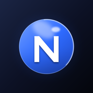
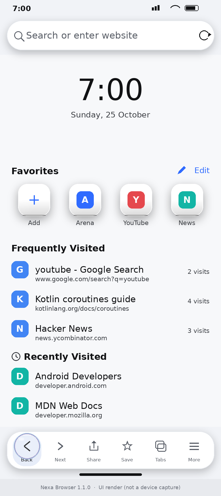
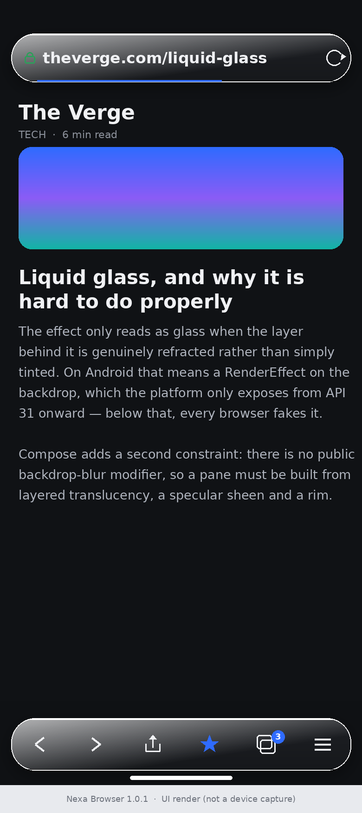
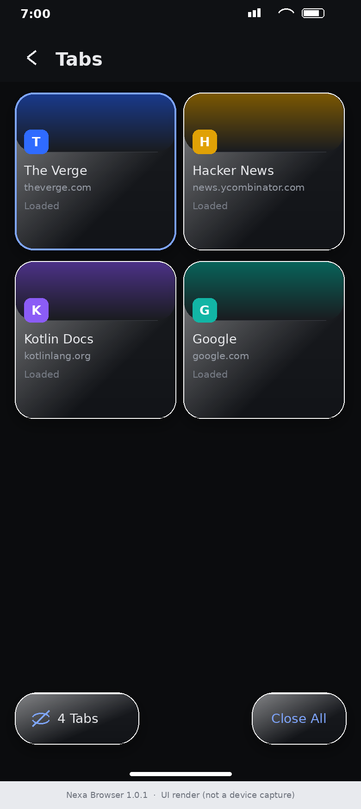
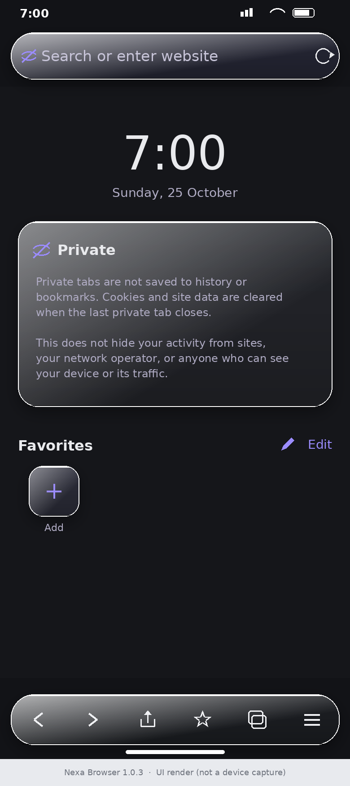
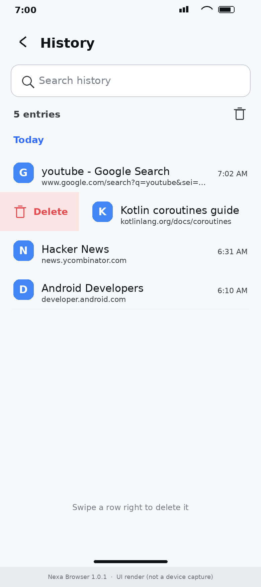
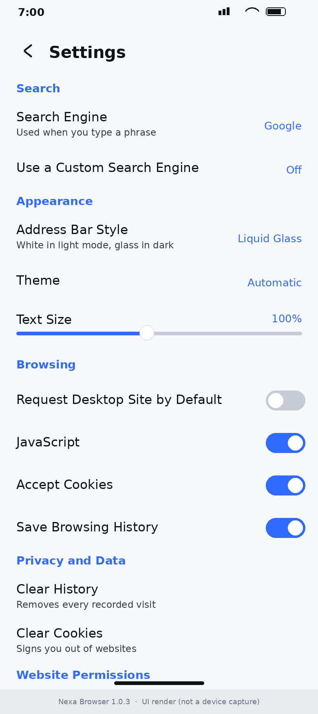
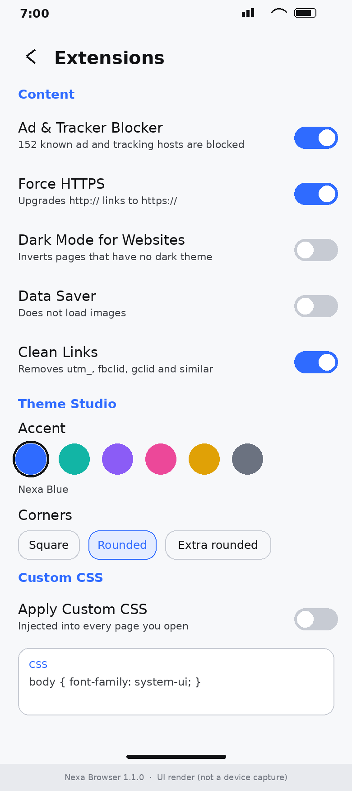

<p align="center"></p>

# Nexa Browser

A complete, working Android web browser with a Safari-inspired, liquid-glass interface.
Built with Kotlin, Jetpack Compose and the system Android WebView (Chromium).

Nexa is a real browser, not a mock-up: it renders live websites, keeps real tab
state, persists real history and bookmarks, and downloads real files.

* **Package name:** `com.nexabrowser.app`
* **Application name:** Nexa Browser
* **Min SDK:** 26 (Android 8.0) · **Target/compile SDK:** 35
* **Language / UI:** Kotlin, Jetpack Compose, Material 3 (heavily customised)
* **Rendering:** `android.webkit.WebView` (Chromium)

---

## What is implemented

### Browsing
* Live WebView rendering of real sites, with links, forms, cookies, sessions,
  redirects, JavaScript dialogs, HTTP errors and fullscreen HTML video.
* Address bar that tells a URL from a search query:
  `https://example.com` opens the site, `example.com` opens
  `https://example.com`, `localhost:8080` and `192.168.1.10` open over HTTP, and
  `how does android work` runs a search.
* Back, forward, reload/stop, home, new tab, tab counter, menu, and a real
  loading-progress indicator driven by `onProgressChanged`.
* Page title, favicon, and an accurate secure-connection indicator (lock for
  HTTPS, warning for HTTP, private glyph in private tabs).
* Error and offline states rendered as a glass overlay instead of a blank page.
* Find on page, share, copy link, and a per-tab "request desktop site" toggle.
* A **liquid-glass dock** at the bottom, built on the iOS 26 model. A soft
  capsule glides between slots on a spring and stretches in proportion to the
  distance still to travel; a **glass lens then rides on top of the row**, so the
  active icon is seen *through* it — enlarged, brightened, with a chromatic
  fringe on the rim. Each control has an icon and a label.
* The start-page clock is drawn as **translucent glass numerals** (a light rim
  plus a filled gradient) whenever a wallpaper is set, the way the lock screen
  does it.
* Keyboard-aware address input (the bar lifts with the IME).

### Search engines
Google (default), Bing, DuckDuckGo, Brave Search, plus a custom URL template
(use `%s` for the query). Configured in Settings and applied immediately.

### Tabs
Create, close, duplicate, switch, reorder-by-creation, and close all with a
confirmation. Each tab owns its own WebView and therefore its own navigation
history and scroll position. Recently closed tabs can be reopened. Tabs are
persisted as URLs and restored on the next launch.

### Private browsing
A visually distinct dark mode with its own tab set. Private visits are never
written to history, bookmarks or the reading list. When the last private tab
closes, the session's DOM storage, WebView cache and (optionally) cookies are
cleared. **The limitations are documented honestly in
`PrivateBrowsingManager`** — see "Known limitations" below.

### Start page
Clock and date, user-managed favourites (add, rename, reorder, delete),
frequently visited sites computed from *real* stored history, and recent visits.
No fabricated or seeded sample data anywhere. Six background presets.

### Bookmarks, History, Reading List
* Bookmarks: add/remove, edit title and URL, folders, shown on the start page.
* History: grouped by day, searchable. Rows are removed by **swiping right** —
  there is no delete button on the row. Bulk clearing by range (last hour /
  today / last week / all) lives in the toolbar. Private sessions are excluded.
* Reading list: save for later, open, remove, and a genuine offline copy via
  `WebView.saveWebArchive` — the "available offline" badge only appears once the
  archive file actually exists on disk.

### Downloads
Built on Android's `DownloadManager`. Shows file name, size, live progress and
status; supports cancel, retry, open and remove; de-duplicates file names;
handles interruption and failure with real reason codes from the system. Progress
is read from the DownloadManager cursor — nothing is faked.

### Extensions

Every extension changes real behaviour; none of them are decorative switches.

| Extension | What it actually does |
|---|---|
| **Ad & Tracker Blocker** | Answers requests to ~150 known advertising, analytics and attribution hosts with an empty response inside `shouldInterceptRequest`. Host and all its subdomains are matched, so the page still loads normally. The list ships in `assets/blocklist.txt` and is deliberately conservative. |
| **Force HTTPS** | Rewrites `http://` navigations to `https://` before the WebView loads them. `localhost`, `127.x`, `::1`, `10.0.2.2` and `.local` are left alone so local testing still works. |
| **Dark Mode for Websites** | Injects a stylesheet that inverts the page while re-inverting images, video, canvas and background images, so photos keep their true colours. |
| **Data Saver** | Sets `loadsImagesAutomatically = false`, so pages load without images. |
| **Clean Links** | Strips `utm_*`, `fbclid`, `gclid`, `msclkid`, `mc_cid` and similar tracking parameters before a URL is loaded. |
| **Custom CSS** | Injects your own stylesheet into every page. |
| **Theme Studio** | Changes the app's accent colour (six presets) and corner roundness (square / rounded / extra rounded). This is the "theme / app UI" extension. |

Page-level extensions are delivered as a single `<style id="nexa-extension-style">`
element injected on `onPageFinished` and re-injected whenever a setting changes,
so toggling one takes effect on the open page immediately. No JavaScript bridge
is exposed to pages — the injection is one-way, from the app into the document.

### Settings
Every setting on the screen changes real behaviour:

| Setting | Effect |
|---|---|
| Search engine / custom URL | Changes the address-bar query template |
| Homepage, New-tab behaviour | Changes where a new tab lands |
| Theme (automatic/light/dark) | Rebuilds the Material colour scheme |
| Text size | Applies `WebSettings.textZoom` |
| Desktop site by default | Applies a desktop user agent |
| JavaScript | Applies `WebSettings.javaScriptEnabled` |
| Pop-ups | Applies `javaScriptCanOpenWindowsAutomatically` + `setSupportMultipleWindows` |
| Cookies | Applies `CookieManager.setAcceptCookie` and third-party cookies |
| Save history | Gates history writes |
| Do Not Track | Injects a `navigator.doNotTrack` shim into each page |
| Restore tabs on start | Gates session restore |
| Start-page clock / background | Changes the start page |
| Address Bar Style | Liquid Glass (default), solid light (black on white), or solid themed |
| Download over Wi-Fi only | Sets `setAllowedOverMetered(false)` |
| Download notifications | Switches the DownloadManager notification visibility |
| Clear history / cache / cookies / website data | Calls the matching platform API |
| Website permissions | Lists remembered camera/mic/location decisions and revokes them |

### Security
* `onReceivedSslError` **always** calls `cancel()`. The app never calls
  `proceed()`, so a MITM certificate cannot be accepted. There is no
  "continue anyway" path.
* A Network Security Configuration blocks cleartext by default, trusts only
  system CAs, and permits HTTP only for `localhost`, `127.0.0.1` and `10.0.2.2`.
* `allowFileAccessFromFileURLs` and `allowUniversalAccessFromFileURLs` are off,
  and a remote page is blocked from navigating the WebView onto `file://`.
* `javascript:` URLs in links are refused. No JavaScript interface is ever
  registered, so no Java object is exposed to page script.
* Mixed content is never allowed (`MIXED_CONTENT_NEVER_ALLOW`).
* Only a small allow-list of schemes (`mailto`, `tel`, `sms`, `geo`, `market`,
  `intent`, `whatsapp`, `upi`) is handed to external apps.
* Camera, microphone and location are denied unless the user grants them through
  an in-app prompt, and decisions can be remembered or revoked.
* No analytics, no telemetry, no background network requests, and no plaintext
  password storage.

---

## Screens

These images are **UI renders** produced from the same design tokens, sizes and
strings as the app, drawn on the build machine. No emulator can run in the build
sandbox (the host has no KVM), so they are not photographs of a device. Install
the APK to see the real thing.

| | |
|---|---|
|  |  |
| **Start page** — clock, favourites, frequently visited from real history | **Browsing** — Liquid Glass bars, page inset below the chrome |
|  |  |
| **Tab switcher** — card per tab, live title and load state | **Private browsing** — distinct dark palette and honest notice |
|  |  |
| **History** — swipe a row right to delete it | **Settings** — every option changes real behaviour |
|  | |
| **Extensions** — ad blocker, HTTPS, dark pages, data saver, Theme Studio | |

The renders include the opaque chrome strip and the inset page, matching the app.

---

## Project layout

```
app/src/main/java/com/nexabrowser/app/
├── MainActivity.kt                     Activity; implements BrowserActivityHost
├── NexaApplication.kt                  WebView warm-up, debug setup
├── browser/                            The engine
│   ├── BrowserTab.kt                   TabInfo + BrowserTab (owns one WebView)
│   ├── BrowserTabManager.kt            Tab lifecycle, active tab, session, sink
│   ├── BrowserWebViewFactory.kt        WebView setup + WebViewClient/ChromeClient
│   ├── BrowserNavigationController.kt  back/forward/reload/stop/load
│   ├── BrowserActivityHost.kt          Platform callbacks the engine needs
│   ├── DelegatingActivityHost.kt       Leak-free indirection to the Activity
│   ├── PrivateBrowsingManager.kt       Private session lifecycle + data clearing
│   └── PageError.kt                    Load-failure model
├── data/
│   ├── local/                          Room database, entities, DAOs
│   ├── prefs/SettingsDataStore.kt      DataStore-backed BrowserSettings
│   └── repository/                     BrowserRepository, DownloadRepository
├── domain/model/                       Bookmark, HistoryEntry, DownloadItem, …
├── ui/
│   ├── BrowserScreen.kt                WebView surface, address bar, toolbar
│   ├── BrowserViewModel.kt             All UI state + orchestration
│   ├── NexaApp.kt                      Root composable, overlays, back handling
│   ├── components/                     AddressBar, BottomToolbar, menu, glass bits
│   ├── screens/                        Start page, tabs, bookmarks, history,
│   │                                   downloads, reading list, settings
│   └── theme/                          Colours, type, glass surface, NexaIcons
└── util/                               UrlUtils (pure, unit-tested), FaviconStore
```

State flows one way: `WebView` events → `BrowserTabManager` (a `TabEventSink`) →
`TabInfo` `StateFlow` → `BrowserViewModel` → Compose. The engine never holds an
Activity reference; `DelegatingActivityHost` is the only bridge, and it is
cleared in `onDestroy`.

---

## Build and install

Requirements: JDK 17, Android SDK Platform 35, Build-Tools 35.0.0.

```bash
# Debug APK
./gradlew :app:assembleDebug
# -> app/build/outputs/apk/debug/app-debug.apk

# Unit tests
./gradlew :app:testDebugUnitTest

# Release build (minified)
./gradlew :app:assembleRelease
```

Install on a device or emulator:

```bash
adb install -r app/build/outputs/apk/debug/app-debug.apk
```

The debug variant has the application id `com.nexabrowser.app.debug` so it can
sit alongside a release build.

If you build on a machine with little RAM, `gradle.properties` already sets a
modest heap, `org.gradle.workers.max`, and in-process Kotlin compilation.

---

## Tests

**Unit tests (run, passing — 38 tests):**

```
./gradlew :app:testDebugUnitTest
com.nexabrowser.app.util.UrlUtilsTest         18 tests, 0 failures
com.nexabrowser.app.domain.SearchEngineTest    6 tests, 0 failures
com.nexabrowser.app.util.FaviconSizingTest     7 tests, 0 failures
com.nexabrowser.app.util.FaviconPathCacheTest  7 tests, 0 failures
```

They cover the address-bar resolver (URL vs search, host:port, IP, localhost,
percent-encoding, custom templates), secure-scheme detection, URL display and
origin extraction, and search-engine/theme/new-tab parsing. One of them caught a
real bug during development: `localhost:8080` was initially misread as a URL
scheme, and the resolver was fixed accordingly.

**Instrumented tests (written, not run here):**
`app/src/androidTest/.../BrowserPersistenceTest.kt` exercises Room-backed
bookmark toggling, history recording and de-duplication, permission memory, and
session-tab round-tripping. These need a device or emulator:

```
./gradlew :app:connectedDebugAndroidTest
```

**Not performed in this environment:** no emulator or physical device was
available, so the app was never launched on Android. Everything below that
depends on runtime behaviour is verified by compilation and code review only —
see "Known limitations".

---

## Known limitations

### WebView compatibility (not Safari)
Nexa renders with the *system* WebView, whose engine version depends on the
device. Sites that need a newer Chromium, or features the installed WebView lacks
(WebRTC codecs, some PWA/Web App Manifest behaviours, certain CSS features, some
DRM/EME video), may render differently from Safari, Chrome or Firefox. WebView
also cannot match a standalone browser's process isolation.

### Private browsing is not isolated storage
Android WebView has **one** app-wide cookie store and HTTP cache. There is no
per-tab incognito profile. Therefore:
* Clearing the private session also clears data that regular tabs may have set.
* Cookies set inside a private tab remain visible to regular tabs until the
  session ends.
True isolation would require running private tabs in a separate process with its
own WebView data directory.

Private mode also does not hide activity from websites, the network operator, an
employer, or anyone who can observe the device or its traffic. The app does not
claim otherwise.

### Tab previews are not screenshots
Tab cards show the live title, favicon and origin, not a rasterised thumbnail.
Drawing a detached WebView is unreliable across OEM WebView builds and costs a
lot of memory per tab.

### Chrome and the page
The bars sit on an **opaque chrome strip** and the page is **inset** by the
chrome height, so a site's own header can never run underneath the address bar.
That was the cause of the "two search bars" look: before, a page like a Google
results page rendered its own search field directly behind the floating bar.

The app draws exactly one search/address bar. A website's own search field is
page content and is not removable — it now sits cleanly below the chrome instead
of behind it.

### Glass and backdrop blur
Settings offers three bar styles: **Liquid Glass** (the default), Solid light
(black on white) and Solid themed.

The Liquid Glass pane is a five-layer composite — a three-stop body gradient, a
diagonal specular sheen, a rim-light border, a lit top lip and a shaded bottom
edge — over a soft elevation shadow. Every glass surface in the app (bars, tab
cards, shortcut tiles, the find bar, the error card, the tab-switcher controls)
uses it, so the visual language stays consistent.

Compose exposes no public backdrop-blur modifier, so the pane itself is layered
translucency rather than a real refraction. Where a true backdrop blur *is*
possible it is used: the page genuinely blurs behind the browser menu via a
`RenderEffect` (API 31+).

### Other
* The start page's background is chosen from six presets; an arbitrary image is
  not supported.
* `saveWebArchive` is best-effort: some sites produce a partial archive.
* Session restore stores URLs and titles only. WebView state itself cannot be
  serialised, so restored tabs reload their pages.
* Do Not Track is delivered to page scripts (`navigator.doNotTrack`); WebView
  exposes no API to add the HTTP `DNT` header.
* Download destinations use the public Downloads collection via DownloadManager;
  a custom folder picker is not implemented.

---

## Glass Browser (second app in this repository)

> **Glass Browser now has its own repository:
> [technicalnihilist-lgtm/glass-browser](https://github.com/technicalnihilist-lgtm/glass-browser).**
> Development continues there — this folder is a snapshot of v1.1 and is no
> longer updated. It is kept here only so existing links keep working.

`glass-browser/` holds **Glass Browser** — a separate, much smaller Android
browser: a single-file HTML chrome over a native WebView content surface,
written in Java with no Gradle, shipped as an 85 KB signed APK. It shares the
liquid-glass look and nothing else: different package
(`com.rajok.glassbrowser`), different architecture, its own history.

Highlights: real WebView rendering (no iframe, so sites that forbid embedding
still load), pop-up to new tab, downloads, file pickers, per-tab back/forward
that collapses `http → https → www` redirects, and a screenshot button that
captures the whole window with `PixelCopy` into `Pictures/Glass Browser`.

See [`glass-browser/README.md`](glass-browser/README.md) for details, the build
script and screenshots.

---

## Licence

MIT.

---

## ⭐ Like this work? Give it a star

If you like this app and our work, please **star this repository** ⭐ and **[follow technicalnihilist-lgtm on GitHub](https://github.com/technicalnihilist-lgtm)**. If our work isn't for you, that's completely fine — the choice is yours. Thank you for stopping by!

<details>
<summary><b>🌍 Same message in 32 languages (A–Z + Indian languages)</b></summary>

- **A — Arabic** (العربية): ⭐ إذا أعجبك هذا التطبيق وعملنا، فيرجى منح المستودع نجمة ومتابعتنا. وإذا لم يعجبك عملنا، فلا مشكلة على الإطلاق — القرار قرارك. شكرًا لزيارتك!
- **B — Bengali** (বাংলা): ⭐ যদি আপনার এই অ্যাপ এবং আমাদের কাজ ভালো লাগে, তবে অনুগ্রহ করে রিপোজিটরিটিকে একটি স্টার দিন এবং আমাদের ফলো করুন। আমাদের কাজ যদি আপনার পছন্দ না হয়, তাতেও কোনো সমস্যা নেই — সিদ্ধান্ত আপনার। আমাদের পেজে আসার জন্য ধন্যবাদ!
- **C — Chinese** (中文): ⭐ 如果你喜欢这个应用和我们的作品，请给仓库点个星标并关注我们。如果我们的作品不适合你，也完全没关系——选择权在你。感谢你的到访！
- **D — Dutch** (Nederlands): ⭐ Vind je deze app en ons werk leuk? Geef de repository dan een ster en volg ons. Vind je ons werk niets, dan is dat helemaal prima — de keuze is aan jou. Bedankt voor je bezoek!
- **E — English** (English): ⭐ If you like this app and our work, please give the repository a star and follow us. If our work isn't for you, that's completely fine — the choice is yours. Thank you for stopping by!
- **F — French** (Français): ⭐ Si cette application et notre travail vous plaisent, mettez une étoile au dépôt et suivez-nous. Si notre travail n'est pas pour vous, aucun souci — c'est votre choix. Merci de votre visite !
- **G — German** (Deutsch): ⭐ Wenn dir diese App und unsere Arbeit gefallen, gib dem Repository einen Stern und folge uns. Wenn unsere Arbeit nichts für dich ist, ist das völlig in Ordnung — die Wahl liegt bei dir. Danke fürs Vorbeischauen!
- **H — Hindi** (हिन्दी): ⭐ अगर आपको यह ऐप और हमारा काम पसंद है, तो कृपया रिपॉजिटरी को स्टार दें और हमें फॉलो करें। अगर हमारा काम आपके लिए नहीं है, तो भी कोई बात नहीं — यह पूरी तरह आपकी मर्ज़ी है। यहाँ आने के लिए आपका धन्यवाद!
- **I — Indonesian** (Bahasa Indonesia): ⭐ Jika kamu suka aplikasi ini dan karya kami, beri bintang pada repositori ini dan ikuti kami. Kalau karya kami bukan untukmu, tidak masalah sama sekali — itu pilihanmu. Terima kasih sudah mampir!
- **J — Japanese** (日本語): ⭐ このアプリと私たちの仕事が気に入ったら、リポジトリにスターを付けてフォローしてください。合わない場合はまったく問題ありません — 選ぶのはあなたです。お越しいただきありがとうございます！
- **K — Korean** (한국어): ⭐ 이 앱과 저희 작업이 마음에 드신다면 저장소에 스타를 눌러 주시고 팔로우해 주세요. 저희 작업이 맞지 않으셔도 전혀 괜찮습니다 — 선택은 여러분의 몫입니다. 방문해 주셔서 감사합니다!
- **L — Lithuanian** (Lietuvių): ⭐ Jei tau patinka ši programa ir mūsų darbas, duok saugyklai žvaigždutę ir sek mus. Jei mūsų darbas ne tau, viskas gerai — pasirinkimas tavo. Ačiū, kad užsukai!
- **M — Malayalam** (മലയാളം): ⭐ നിങ്ങൾക്ക് ഈ ആപ്പും ഞങ്ങളുടെ പ്രവർത്തനവും ഇഷ്ടപ്പെട്ടെങ്കിൽ, ദയവായി റെപ്പോസിറ്ററിക്ക് ഒരു സ്റ്റാർ നൽകുകയും ഞങ്ങളെ ഫോളോ ചെയ്യുകയും ചെയ്യുക. ഞങ്ങളുടെ പ്രവർത്തനം നിങ്ങൾക്ക് അനുയോജ്യമല്ലെങ്കിൽ, അതും തികച്ചും കുഴപ്പമില്ല — തീരുമാനം നിങ്ങളുടേതാണ്. ഇവിടെ വന്നതിന് നന്ദി!
- **N — Nepali** (नेपाली): ⭐ यदि तपाईंलाई यो एप र हाम्रो काम मन पर्‍यो भने, कृपया रिपोजिटरीलाई स्टार दिनुहोस् र हामीलाई फलो गर्नुहोस्। यदि हाम्रो काम तपाईंलाई मन पर्दैन भने, पनि ठीकै छ — यो तपाईंको इच्छा हो। यहाँ आउनुभएकोमा धन्यवाद!
- **O — Odia** (ଓଡ଼ିଆ): ⭐ ଯଦି ଆପଣଙ୍କୁ ଏହି ଆପ୍ ଏବଂ ଆମର କାମ ଭଲ ଲାଗୁଛି, ତେବେ ଦୟାକରି ରିପୋଜିଟୋରୀକୁ ଗୋଟିଏ ଷ୍ଟାର୍ ଦିଅନ୍ତୁ ଏବଂ ଆମକୁ ଫଲୋ କରନ୍ତୁ। ଯଦି ଆମର କାମ ଆପଣଙ୍କ ପାଇଁ ନୁହେଁ, ତେବେ କିଛି ଅସୁବିଧା ନାହିଁ — ପସନ୍ଦ ଆପଣଙ୍କର। ଆମ ପାଖକୁ ଆସିଥିବାରୁ ଧନ୍ୟବାଦ!
- **P — Polish** (Polski): ⭐ Jeśli podoba Ci się ta aplikacja i nasza praca, daj repozytorium gwiazdkę i obserwuj nas. Jeśli nasza praca nie jest dla Ciebie, to zupełnie w porządku — wybór należy do Ciebie. Dziękujemy za odwiedziny!
- **Q — Quechua** (Runa Simi): ⭐ Kay app, ñuqaykup ruwasqanchikpas gustasunki chayqa, repositorioman huk estrella churay, ñuqaykutapas qatipayku. Mana gustasunki chayqa, allinmi — qampa akllayki. Hamusqaykimanta sulpayki!
- **R — Russian** (Русский): ⭐ Если вам нравится это приложение и наша работа, поставьте звёздочку репозиторию и подпишитесь на нас. Если наша работа не для вас — это совершенно нормально, выбор за вами. Спасибо, что заглянули!
- **S — Spanish** (Español): ⭐ Si te gusta esta app y nuestro trabajo, dale una estrella al repositorio y síguenos. Si nuestro trabajo no es para ti, no pasa nada — la decisión es tuya. ¡Gracias por pasarte!
- **T — Tamil** (தமிழ்): ⭐ உங்களுக்கு இந்த ஆப்பும் எங்க வேலையும் பிடிச்சிருந்தா, தயவுசெஞ்சு இந்த ரெபாசிட்டரிக்கு ஒரு ஸ்டார் குடுத்து, எங்களை ஃபாலோ பண்ணுங்க. எங்க வேலை உங்களுக்கு செட் ஆகலைன்னாலும் பரவாயில்லை — அது உங்க விருப்பம். இங்கே வந்ததுக்கு நன்றி!
- **U — Urdu** (اردو): ⭐ اگر آپ کو یہ ایپ اور ہمارا کام پسند آئے تو براہ کرم ریپازٹری کو سٹار دیں اور ہمیں فالو کریں۔ اگر ہمارا کام آپ کے لیے نہیں ہے، تو یہ بالکل ٹھیک ہے — انتخاب آپ کا ہے۔ یہاں تشریف لانے کا شکریہ!
- **V — Vietnamese** (Tiếng Việt): ⭐ Nếu bạn thích ứng dụng này và công việc của chúng tôi, hãy tặng kho lưu trữ một ngôi sao và theo dõi chúng tôi. Nếu công việc của chúng tôi không phù hợp với bạn, điều đó hoàn toàn ổn — lựa chọn là của bạn. Cảm ơn bạn đã ghé qua!
- **W — Welsh** (Cymraeg): ⭐ Os ydych chi'n hoffi'r ap hwn a'n gwaith, rhowch seren i'r storfa a dilynwch ni. Os nad yw ein gwaith ar eich cyfer, mae hynny'n hollol iawn — chi sydd i benderfynu. Diolch am alw heibio!
- **X — Xhosa** (isiXhosa): ⭐ Ukuba uyayithanda le app nomsebenzi wethu, nika irepo inkwenkwezi kwaye usilandele. Ukuba umsebenzi wethu awukufanelanga, akukho ngxaki — lukhetho lwakho. Enkosi ngokutyelela!
- **Y — Yoruba** (Yorùbá): ⭐ Bí app yìí àti iṣẹ́ wa bá wù ọ́, jọ̀wọ́ fún àkójọpọ̀ náà ní ìràwọ̀ kí o sì tẹ̀lé wa. Bí iṣẹ́ wa kò bá yẹ ọ́, kò séwu — ìwọ ni ó yàn. Ẹ ṣé fún wíwá!
- **Z — Zulu** (isiZulu): ⭐ Uma uthanda le app nomsebenzi wethu, nikeza isitoreji inkanyezi bese usilandela. Uma umsebenzi wethu ungakufanele, akunankinga — wukukhetha kwakho. Siyabonga ngokuvakasha!

**More Indian languages**

- **Assamese** (অসমীয়া): ⭐ যদি আপুনি এই এপটো আৰু আমাৰ কাম ভাল পায়, তেন্তে অনুগ্ৰহ কৰি ৰিপজিটৰীটোক এটা ষ্টাৰ দিয়ক আৰু আমাক ফ'ল' কৰক। যদি আমাৰ কাম আপোনাৰ বাবে নহয়, তেন্তে সেয়া একেবাৰে ঠিক আছে — সিদ্ধান্তটো আপোনাৰ। আমাৰ ইয়ালৈ অহাৰ বাবে ধন্যবাদ!
- **Gujarati** (ગુજરાતી): ⭐ જો તમને આ એપ અને અમારું કામ ગમતું હોય, તો પ્લીઝ રિપોઝિટરીને સ્ટાર આપો અને અમને ફોલો કરો. જો અમારું કામ તમને ન ગમતું હોય, તો તે પણ બરાબર છે — પસંદગી તમારી છે. અહીં આવવા બદલ આભાર!
- **Kannada** (ಕನ್ನಡ): ⭐ ನಿಮಗೆ ಈ ಆ್ಯಪ್ ಮತ್ತು ನಮ್ಮ ಕೆಲಸ ಇಷ್ಟವಾದರೆ, ದಯವಿಟ್ಟು ರೆಪೊಸಿಟರಿಗೆ ಸ್ಟಾರ್ ಕೊಡಿ ಮತ್ತು ನಮ್ಮನ್ನು ಫಾಲೋ ಮಾಡಿ. ನಮ್ಮ ಕೆಲಸ ನಿಮಗೆ ಸರಿಹೊಂದದಿದ್ದರೆ, ಅದೂ ಪರವಾಗಿಲ್ಲ — ಆಯ್ಕೆ ನಿಮ್ಮದು. ಭೇಟಿ ನೀಡಿದ್ದಕ್ಕೆ ಧನ್ಯವಾದಗಳು!
- **Marathi** (मराठी): ⭐ जर तुम्हाला हे ॲप आणि आमचं काम आवडलं असेल, तर कृपया रिपॉझिटरीला स्टार द्या आणि आम्हाला फॉलो करा. जर आमचं काम तुम्हाला आवडत नसेल, तर काही हरकत नाही — ती तुमची निवड आहे. इथे आल्याबद्दल धन्यवाद!
- **Punjabi** (ਪੰਜਾਬੀ): ⭐ ਜੇ ਤੁਹਾਨੂੰ ਇਹ ਐਪ ਅਤੇ ਸਾਡਾ ਕੰਮ ਪਸੰਦ ਹੈ, ਤਾਂ ਕਿਰਪਾ ਕਰਕੇ ਰਿਪੋਜ਼ਟਰੀ ਨੂੰ ਸਟਾਰ ਦਿਓ ਅਤੇ ਸਾਨੂੰ ਫਾਲੋ ਕਰੋ। ਜੇ ਸਾਡਾ ਕੰਮ ਤੁਹਾਡੇ ਲਈ ਨਹੀਂ ਹੈ, ਤਾਂ ਕੋਈ ਗੱਲ ਨਹੀਂ — ਚੋਣ ਤੁਹਾਡੀ ਹੈ। ਸਾਡੇ ਪੇਜ 'ਤੇ ਆਉਣ ਲਈ ਧੰਨਵਾਦ!
- **Telugu** (తెలుగు): ⭐ మీకు ఈ యాప్, మా పని నచ్చితే, దయచేసి రిపోజిటరీకి ఒక స్టార్ ఇచ్చి మమ్మల్ని ఫాలో అవ్వండి. ఒకవేళ మా పని మీకు నచ్చకపోతే, పర్వాలేదు — అది మీ ఇష్టం. మమ్మల్ని సందర్శించినందుకు ధన్యవాదాలు!

</details>
