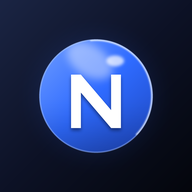
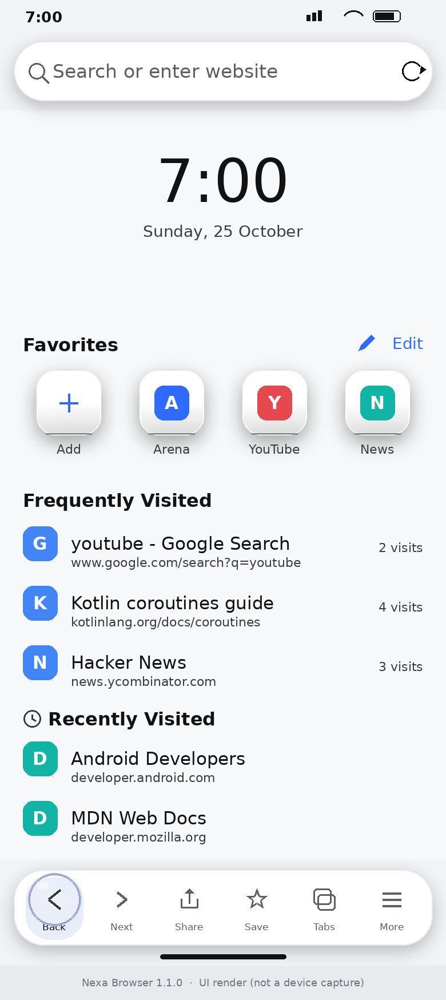
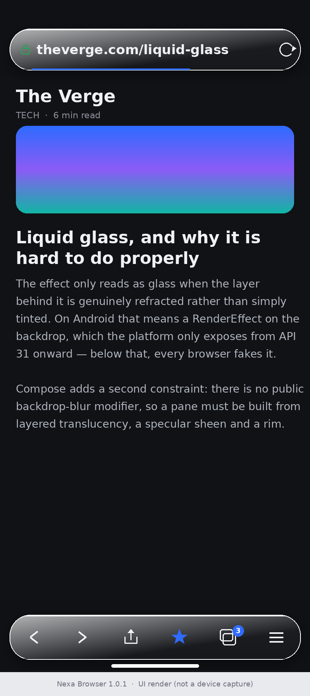
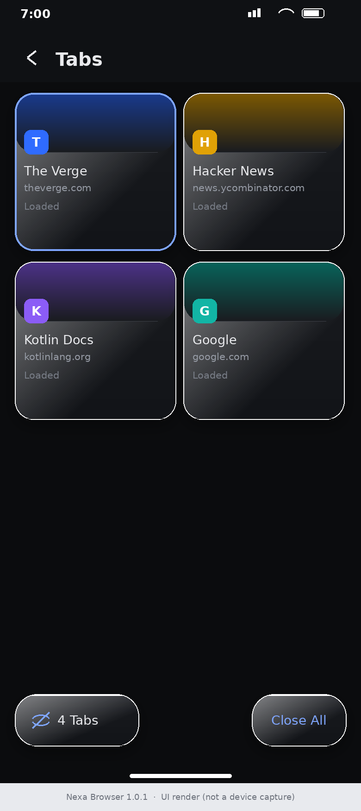
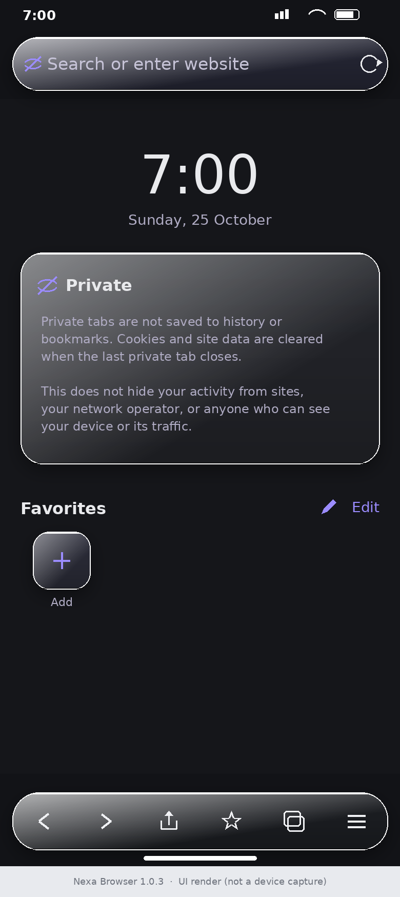
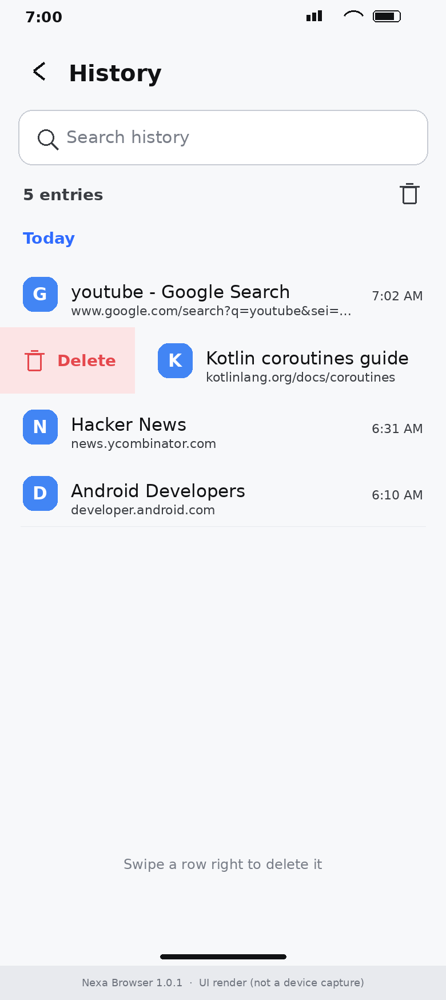
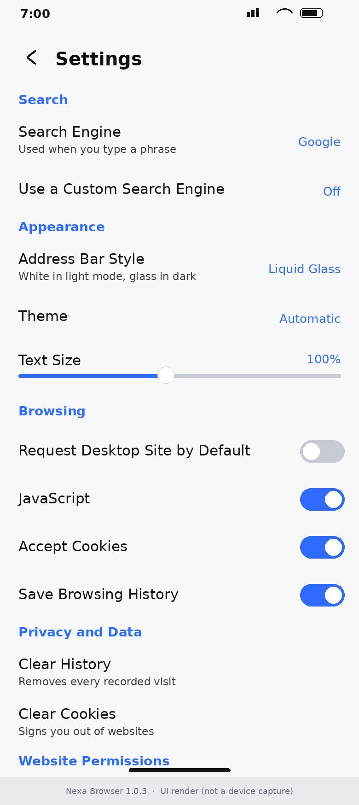

<p align="center"></p>

# Nexa Browser

A complete, working Android web browser with a Safari-inspired, liquid-glass interface.
Built with Kotlin, Jetpack Compose and the system Android WebView (Chromium).

Nexa is a real browser, not a mock-up: it renders live websites, keeps real tab
state, persists real history and bookmarks, and downloads real files.

* **Package name:** `com.nexabrowser.app`
* **Application name:** Nexa Browser
* **Min SDK:** 26 (Android 8.0) · **Target/compile SDK:** 35
* **Language / UI:** Kotlin, Jetpack Compose, Material 3 (heavily customised)
* **Rendering:** `android.webkit.WebView` (Chromium)

---

## What is implemented

### Browsing
* Live WebView rendering of real sites, with links, forms, cookies, sessions,
  redirects, JavaScript dialogs, HTTP errors and fullscreen HTML video.
* Address bar that tells a URL from a search query:
  `https://example.com` opens the site, `example.com` opens
  `https://example.com`, `localhost:8080` and `192.168.1.10` open over HTTP, and
  `how does android work` runs a search.
* Back, forward, reload/stop, home, new tab, tab counter, menu, and a real
  loading-progress indicator driven by `onProgressChanged`.
* Page title, favicon, and an accurate secure-connection indicator (lock for
  HTTPS, warning for HTTP, private glyph in private tabs).
* Error and offline states rendered as a glass overlay instead of a blank page.
* Find on page, share, copy link, and a per-tab "request desktop site" toggle.
* A **liquid-glass dock** at the bottom: one glass capsule carries the active
  slot and, when the active slot changes, it glides there on a spring while
  stretching in proportion to the distance still to travel, then settles. Each
  control has an icon and a label, as in the reference animation.
* Keyboard-aware address input (the bar lifts with the IME).

### Search engines
Google (default), Bing, DuckDuckGo, Brave Search, plus a custom URL template
(use `%s` for the query). Configured in Settings and applied immediately.

### Tabs
Create, close, duplicate, switch, reorder-by-creation, and close all with a
confirmation. Each tab owns its own WebView and therefore its own navigation
history and scroll position. Recently closed tabs can be reopened. Tabs are
persisted as URLs and restored on the next launch.

### Private browsing
A visually distinct dark mode with its own tab set. Private visits are never
written to history, bookmarks or the reading list. When the last private tab
closes, the session's DOM storage, WebView cache and (optionally) cookies are
cleared. **The limitations are documented honestly in
`PrivateBrowsingManager`** — see "Known limitations" below.

### Start page
Clock and date, user-managed favourites (add, rename, reorder, delete),
frequently visited sites computed from *real* stored history, and recent visits.
No fabricated or seeded sample data anywhere. Six background presets.

### Bookmarks, History, Reading List
* Bookmarks: add/remove, edit title and URL, folders, shown on the start page.
* History: grouped by day, searchable. Rows are removed by **swiping right** —
  there is no delete button on the row. Bulk clearing by range (last hour /
  today / last week / all) lives in the toolbar. Private sessions are excluded.
* Reading list: save for later, open, remove, and a genuine offline copy via
  `WebView.saveWebArchive` — the "available offline" badge only appears once the
  archive file actually exists on disk.

### Downloads
Built on Android's `DownloadManager`. Shows file name, size, live progress and
status; supports cancel, retry, open and remove; de-duplicates file names;
handles interruption and failure with real reason codes from the system. Progress
is read from the DownloadManager cursor — nothing is faked.

### Settings
Every setting on the screen changes real behaviour:

| Setting | Effect |
|---|---|
| Search engine / custom URL | Changes the address-bar query template |
| Homepage, New-tab behaviour | Changes where a new tab lands |
| Theme (automatic/light/dark) | Rebuilds the Material colour scheme |
| Text size | Applies `WebSettings.textZoom` |
| Desktop site by default | Applies a desktop user agent |
| JavaScript | Applies `WebSettings.javaScriptEnabled` |
| Pop-ups | Applies `javaScriptCanOpenWindowsAutomatically` + `setSupportMultipleWindows` |
| Cookies | Applies `CookieManager.setAcceptCookie` and third-party cookies |
| Save history | Gates history writes |
| Do Not Track | Injects a `navigator.doNotTrack` shim into each page |
| Restore tabs on start | Gates session restore |
| Start-page clock / background | Changes the start page |
| Address Bar Style | Liquid Glass (default), solid light (black on white), or solid themed |
| Download over Wi-Fi only | Sets `setAllowedOverMetered(false)` |
| Download notifications | Switches the DownloadManager notification visibility |
| Clear history / cache / cookies / website data | Calls the matching platform API |
| Website permissions | Lists remembered camera/mic/location decisions and revokes them |

### Security
* `onReceivedSslError` **always** calls `cancel()`. The app never calls
  `proceed()`, so a MITM certificate cannot be accepted. There is no
  "continue anyway" path.
* A Network Security Configuration blocks cleartext by default, trusts only
  system CAs, and permits HTTP only for `localhost`, `127.0.0.1` and `10.0.2.2`.
* `allowFileAccessFromFileURLs` and `allowUniversalAccessFromFileURLs` are off,
  and a remote page is blocked from navigating the WebView onto `file://`.
* `javascript:` URLs in links are refused. No JavaScript interface is ever
  registered, so no Java object is exposed to page script.
* Mixed content is never allowed (`MIXED_CONTENT_NEVER_ALLOW`).
* Only a small allow-list of schemes (`mailto`, `tel`, `sms`, `geo`, `market`,
  `intent`, `whatsapp`, `upi`) is handed to external apps.
* Camera, microphone and location are denied unless the user grants them through
  an in-app prompt, and decisions can be remembered or revoked.
* No analytics, no telemetry, no background network requests, and no plaintext
  password storage.

---

## Screens

These images are **UI renders** produced from the same design tokens, sizes and
strings as the app, drawn on the build machine. No emulator can run in the build
sandbox (the host has no KVM), so they are not photographs of a device. Install
the APK to see the real thing.

| | |
|---|---|
|  |  |
| **Start page** — clock, user favourites, frequently visited from real history | **Browsing** — Liquid Glass bars floating over a live page |
|  |  |
| **Tab switcher** — card per tab, live title and favicon | **Private browsing** — distinct dark palette and honest notice |
|  |  |
| **History** — swipe a row right to delete it | **Settings** — every option changes real behaviour |

The renders include the opaque chrome strip and the inset page, matching the app.

---

## Project layout

```
app/src/main/java/com/nexabrowser/app/
├── MainActivity.kt                     Activity; implements BrowserActivityHost
├── NexaApplication.kt                  WebView warm-up, debug setup
├── browser/                            The engine
│   ├── BrowserTab.kt                   TabInfo + BrowserTab (owns one WebView)
│   ├── BrowserTabManager.kt            Tab lifecycle, active tab, session, sink
│   ├── BrowserWebViewFactory.kt        WebView setup + WebViewClient/ChromeClient
│   ├── BrowserNavigationController.kt  back/forward/reload/stop/load
│   ├── BrowserActivityHost.kt          Platform callbacks the engine needs
│   ├── DelegatingActivityHost.kt       Leak-free indirection to the Activity
│   ├── PrivateBrowsingManager.kt       Private session lifecycle + data clearing
│   └── PageError.kt                    Load-failure model
├── data/
│   ├── local/                          Room database, entities, DAOs
│   ├── prefs/SettingsDataStore.kt      DataStore-backed BrowserSettings
│   └── repository/                     BrowserRepository, DownloadRepository
├── domain/model/                       Bookmark, HistoryEntry, DownloadItem, …
├── ui/
│   ├── BrowserScreen.kt                WebView surface, address bar, toolbar
│   ├── BrowserViewModel.kt             All UI state + orchestration
│   ├── NexaApp.kt                      Root composable, overlays, back handling
│   ├── components/                     AddressBar, BottomToolbar, menu, glass bits
│   ├── screens/                        Start page, tabs, bookmarks, history,
│   │                                   downloads, reading list, settings
│   └── theme/                          Colours, type, glass surface, NexaIcons
└── util/                               UrlUtils (pure, unit-tested), FaviconStore
```

State flows one way: `WebView` events → `BrowserTabManager` (a `TabEventSink`) →
`TabInfo` `StateFlow` → `BrowserViewModel` → Compose. The engine never holds an
Activity reference; `DelegatingActivityHost` is the only bridge, and it is
cleared in `onDestroy`.

---

## Build and install

Requirements: JDK 17, Android SDK Platform 35, Build-Tools 35.0.0.

```bash
# Debug APK
./gradlew :app:assembleDebug
# -> app/build/outputs/apk/debug/app-debug.apk

# Unit tests
./gradlew :app:testDebugUnitTest

# Release build (minified)
./gradlew :app:assembleRelease
```

Install on a device or emulator:

```bash
adb install -r app/build/outputs/apk/debug/app-debug.apk
```

The debug variant has the application id `com.nexabrowser.app.debug` so it can
sit alongside a release build.

If you build on a machine with little RAM, `gradle.properties` already sets a
modest heap, `org.gradle.workers.max`, and in-process Kotlin compilation.

---

## Tests

**Unit tests (run, passing — 24 tests):**

```
./gradlew :app:testDebugUnitTest
com.nexabrowser.app.util.UrlUtilsTest      18 tests, 0 failures
com.nexabrowser.app.domain.SearchEngineTest 6 tests, 0 failures
```

They cover the address-bar resolver (URL vs search, host:port, IP, localhost,
percent-encoding, custom templates), secure-scheme detection, URL display and
origin extraction, and search-engine/theme/new-tab parsing. One of them caught a
real bug during development: `localhost:8080` was initially misread as a URL
scheme, and the resolver was fixed accordingly.

**Instrumented tests (written, not run here):**
`app/src/androidTest/.../BrowserPersistenceTest.kt` exercises Room-backed
bookmark toggling, history recording and de-duplication, permission memory, and
session-tab round-tripping. These need a device or emulator:

```
./gradlew :app:connectedDebugAndroidTest
```

**Not performed in this environment:** no emulator or physical device was
available, so the app was never launched on Android. Everything below that
depends on runtime behaviour is verified by compilation and code review only —
see "Known limitations".

---

## Known limitations

### WebView compatibility (not Safari)
Nexa renders with the *system* WebView, whose engine version depends on the
device. Sites that need a newer Chromium, or features the installed WebView lacks
(WebRTC codecs, some PWA/Web App Manifest behaviours, certain CSS features, some
DRM/EME video), may render differently from Safari, Chrome or Firefox. WebView
also cannot match a standalone browser's process isolation.

### Private browsing is not isolated storage
Android WebView has **one** app-wide cookie store and HTTP cache. There is no
per-tab incognito profile. Therefore:
* Clearing the private session also clears data that regular tabs may have set.
* Cookies set inside a private tab remain visible to regular tabs until the
  session ends.
True isolation would require running private tabs in a separate process with its
own WebView data directory.

Private mode also does not hide activity from websites, the network operator, an
employer, or anyone who can observe the device or its traffic. The app does not
claim otherwise.

### Tab previews are not screenshots
Tab cards show the live title, favicon and origin, not a rasterised thumbnail.
Drawing a detached WebView is unreliable across OEM WebView builds and costs a
lot of memory per tab.

### Chrome and the page
The bars sit on an **opaque chrome strip** and the page is **inset** by the
chrome height, so a site's own header can never run underneath the address bar.
That was the cause of the "two search bars" look: before, a page like a Google
results page rendered its own search field directly behind the floating bar.

The app draws exactly one search/address bar. A website's own search field is
page content and is not removable — it now sits cleanly below the chrome instead
of behind it.

### Glass and backdrop blur
Settings offers three bar styles: **Liquid Glass** (the default), Solid light
(black on white) and Solid themed.

The Liquid Glass pane is a five-layer composite — a three-stop body gradient, a
diagonal specular sheen, a rim-light border, a lit top lip and a shaded bottom
edge — over a soft elevation shadow. Every glass surface in the app (bars, tab
cards, shortcut tiles, the find bar, the error card, the tab-switcher controls)
uses it, so the visual language stays consistent.

Compose exposes no public backdrop-blur modifier, so the pane itself is layered
translucency rather than a real refraction. Where a true backdrop blur *is*
possible it is used: the page genuinely blurs behind the browser menu via a
`RenderEffect` (API 31+).

### Other
* The start page's background is chosen from six presets; an arbitrary image is
  not supported.
* `saveWebArchive` is best-effort: some sites produce a partial archive.
* Session restore stores URLs and titles only. WebView state itself cannot be
  serialised, so restored tabs reload their pages.
* Do Not Track is delivered to page scripts (`navigator.doNotTrack`); WebView
  exposes no API to add the HTTP `DNT` header.
* Download destinations use the public Downloads collection via DownloadManager;
  a custom folder picker is not implemented.

---

## Licence

MIT.
