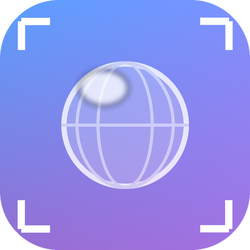
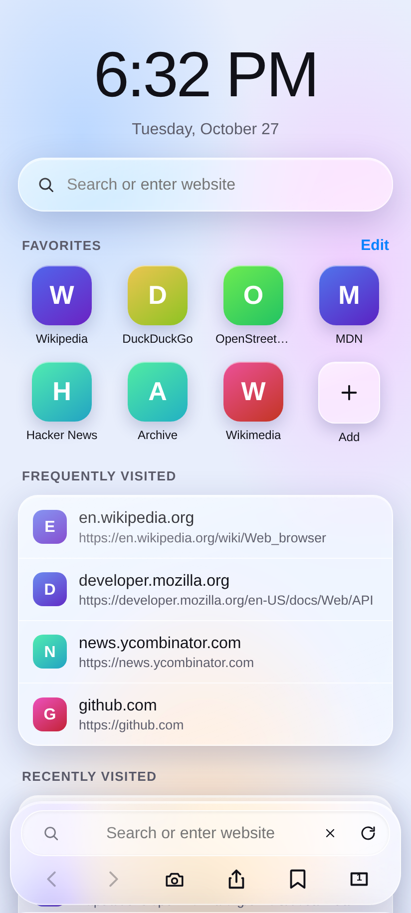
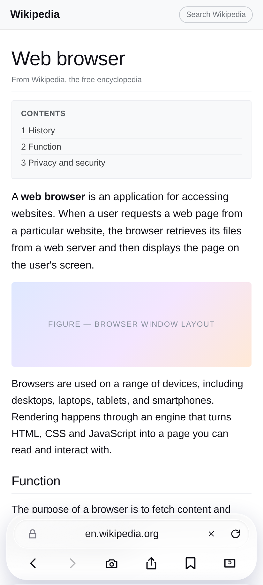
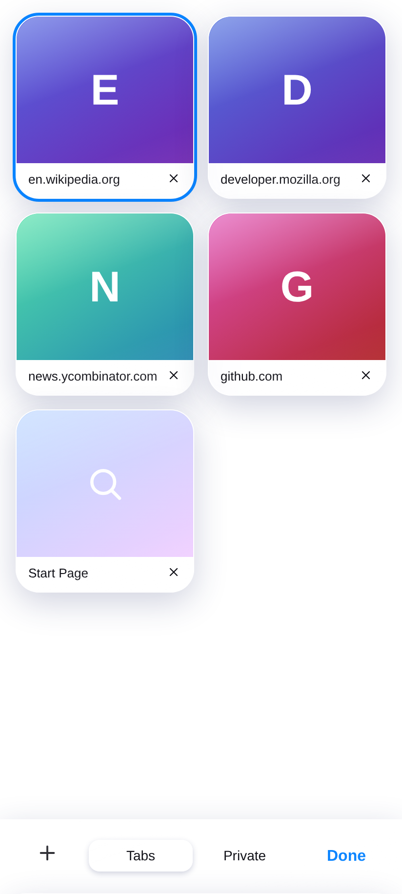
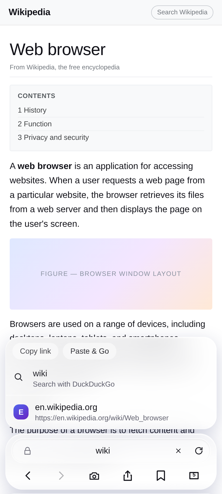
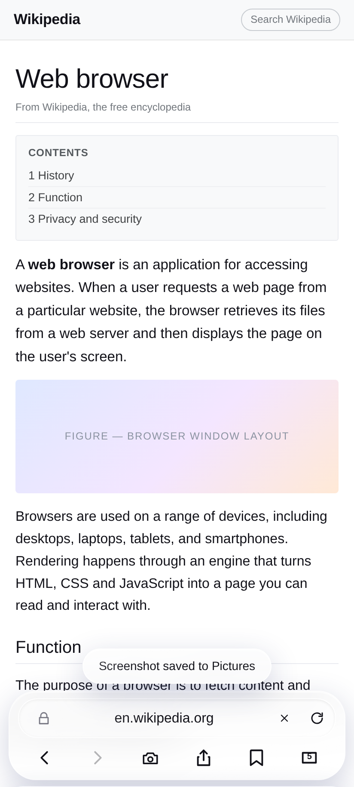
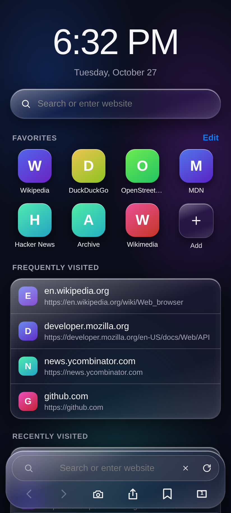

<p align="center"></p>

# Glass Browser

> **Version 1.1** · [**Download the signed APK**](https://github.com/technicalnihilist-lgtm/nexa-browser/releases/download/glass-browser-v1.1/GlassBrowser.apk) · [all releases](https://github.com/technicalnihilist-lgtm/nexa-browser/releases)
>
> 89 KB · Android 7.0+ · no ads, no account, no analytics

A complete, working Android web browser with a liquid-glass interface.
The chrome is a single HTML/CSS file; the pages are rendered by the system
Android **WebView** (Chromium). Nothing is a mock-up — it loads real sites,
keeps real tabs and history, downloads real files and takes real screenshots.

* **Package name:** `com.rajok.glassbrowser`
* **Application name:** Glass Browser
* **Min SDK:** 24 (Android 7.0) · **Target / compile SDK:** 34 (Android 14)
* **Language / UI:** Java + a single-file HTML/CSS/JS interface
* **Rendering:** `android.webkit.WebView` (Chromium)
* **APK size:** ~90 KB, signed and installable as-is

---

## Why it is a real browser and not a wrapped web page

The obvious way to build a browser out of an HTML file is an `<iframe>`. That
does not work: nearly every large site sends `X-Frame-Options: DENY` or a
`frame-ancestors` CSP, so Google, Wikipedia, YouTube and most banks refuse to
load. The original prototype had exactly this problem.

Glass Browser splits the job in two:

| Layer | What it is | Job |
| --- | --- | --- |
| **Chrome** | a `WebView` loading `assets/index.html`, transparent, pinned to the bottom | address bar, tabs, sheets, settings — all the glass UI |
| **Content** | one `WebView` per tab, full size, behind the chrome | renders the actual page with real Chromium |

The two talk over a `@JavascriptInterface` bridge. The chrome resizes itself on
demand (`setChrome(px)`): a ~120 dp strip while you browse, and full-screen the
moment the start page, tab switcher, a sheet or the address-bar suggestions
appear — so the glass panels float over the live page with the page visible
behind them.

Every tab owns its own content WebView, so switching tabs keeps the page exactly
as you left it — scroll position, half-filled forms, a playing video. Only the
visible one is drawn; the rest sit paused behind it. Live WebViews are capped by
the device's memory class (2–6, from `ActivityManager.getMemoryClass()`) and the
least recently used one is destroyed when the cap is reached. Its URL lives in
the tab list, so returning to it reloads the page rather than losing the tab.

---

## What is implemented

### Browsing
* Real WebView rendering of any site — links, forms, cookies, sessions,
  redirects, HTTP auth, HTML5 video, file uploads.
* Address bar that tells a URL from a search query: `example.com` opens the
  site, `wikipedia` searches. Engine is switchable (DuckDuckGo, Google, Bing,
  Ecosia, Wikipedia).
* Back / forward per tab, with a stack that understands the difference between
  a link you tapped and a server redirect — a `http → https → www` hop replaces
  the entry instead of piling up three of them.
* Pop-ups and `target="_blank"` links open as new tabs (a throwaway WebView
  catches the URL, then the tab is created for real).
* Downloads go through Android's `DownloadManager` with cookies and user agent
  attached, and land in the Downloads folder with a notification.
* File pickers for `<input type="file">` use the system document picker.
* Hardware back closes the open sheet, then the tab switcher, then walks the
  tab's history, then exits.

### Heavy pages
* The renderer dying — what Chromium does when a very large page exhausts memory —
  is caught with `onRenderProcessGone` instead of taking the whole app down with
  it. The dead views are torn down and the current tab reloads.
* Progress callbacks are throttled (one every 5%, not one per percent), and
  `localStorage` writes are debounced, so single-page apps that rewrite their URL
  on every scroll cannot stall the UI.
* Pop-ups use a throwaway WebView to capture the target URL; it is removed and
  destroyed as soon as the URL is known, and after 4 seconds if the popup never
  navigates.

### Screenshots
The camera button in the toolbar captures the **whole window** with
`PixelCopy` — page *and* toolbar, exactly what you see — and writes a PNG to
`Pictures/Glass Browser` through `MediaStore` (or the public Pictures directory
plus a media scan on Android 9 and below). A toast confirms the save.

### Tabs
* Normal and private tabs, with private tabs kept out of history and out of
  `localStorage` persistence.
* Tab switcher with live coloured previews, close buttons, and per-mode lists.
* Each tab keeps its own WebView, so switching back to a tab resumes it instead
  of reloading. The tab list can never empty itself: closing the last tab opens
  a fresh one.
* Tabs, history (400 entries), bookmarks and favourites survive app restarts.

### Start page
Live clock, favourites grid (editable, add and remove), frequently visited and
recently visited lists, and a search field — all rendered from real history.

### Privacy and security
* Invalid TLS certificates are **blocked**, not bypassed.
* `javascript:`, `data:`, `file:` and `blob:` addresses are refused.
* Camera and microphone requests are declined; geolocation is declined.
* Referrer can be suppressed; history and all browsing data can be wiped from
  Settings.
* Private tabs are never written to disk.

### Interface
Light and dark themes (follows the system, or forced), a private-mode purple
tint, safe-area insets for notches and gesture bars, glass panels with real
backdrop blur, and reduced-motion support.

---

## Screenshots

| Start page | Browsing |
| --- | --- |
|  |  |

| Tab switcher | Address bar suggestions |
| --- | --- |
|  |  |

| Screenshot saved | Dark mode |
| --- | --- |
|  |  |

---

## Install

The signed APK is in the repository root: **[`GlassBrowser.apk`](GlassBrowser.apk)**.

1. Copy it to the phone and tap it.
2. Allow installs from your browser / Files app when Android asks.
3. Install, then Open. Play Protect may offer to scan an app from outside the
   Play Store — choose *Install anyway*.

It is signed with a self-signed key, so it cannot be updated from a build signed
with a different key. Uninstall the old copy first if you rebuild it yourself.

---

## Build

No Gradle, no Android Studio project — the build is a shell script that calls
`aapt2`, `javac`, `d8`, `zipalign` and `apksigner` directly, which keeps the APK
at 85 KB.

```bash
export ANDROID_SDK=$HOME/Android/Sdk      # needs build-tools 34 + platform android-34
./build.sh                                # -> GlassBrowser.apk
```

If no keystore exists, `build.sh` generates one at `./glass.keystore` (ignored by
git). Point `KEYSTORE=/path/to/key.jks` at your own key to sign a release build.

### Layout

```
app/
  AndroidManifest.xml
  assets/index.html                       the entire glass UI (HTML + CSS + JS)
  java/com/rajok/glassbrowser/
    MainActivity.java                     WebView host, bridge, screenshot, downloads
  res/                                    theme, icon
build.sh
screenshots/
```

### How the bridge works

`MainActivity.Bridge` exposes `nav`, `blank`, `stop`, `setChrome`, `setPopups`,
`share`, `openExternal`, `screenshot` and `exit`. The other direction is one
callback, `window.BN.on(json)`:

```js
{ t: 'start' }                          // page load began
{ t: 'prog',   p: 0-100 }
{ t: 'done' }
{ t: 'visited', push: true, url: '…' }  // history entry; push=false means a redirect
{ t: 'error',  desc: '…' }
{ t: 'shot',   ok: true, msg: '…' }
{ t: 'back' }                           // hardware back pressed
```

---

## Known limitations

* **Camera, microphone and location are declined.** Granting them needs runtime
  permission plumbing that is not wired up; the app stays honest and refuses.
* **No ad blocking, no extensions, no reader mode, no sync.** It is a small,
  self-contained browser.
* **Back/forward is tracked by the chrome layer, not by Chromium's own history.**
  This is what lets tabs be independent, but it means a single-page app that
  rewrites its URL with `pushState` will replace the history entry rather than
  add one.
* **Tabs beyond the live cap reload when you return to them.** On a low-memory
  device that cap can be as low as two WebViews.
* **Tested in a browser engine and verified structurally, not on a physical
  handset.** The UI logic has an automated test pass (start page, navigation,
  redirect collapsing, back/forward, tab creation, error panel, chrome
  resizing); the APK is verified as signed and well-formed. Field reports from
  real devices are welcome.

---

## License

MIT — see [LICENSE](LICENSE).
